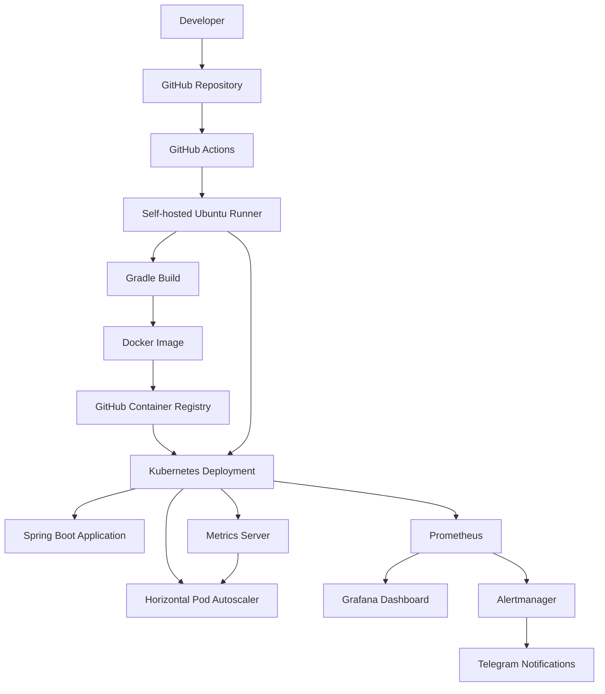
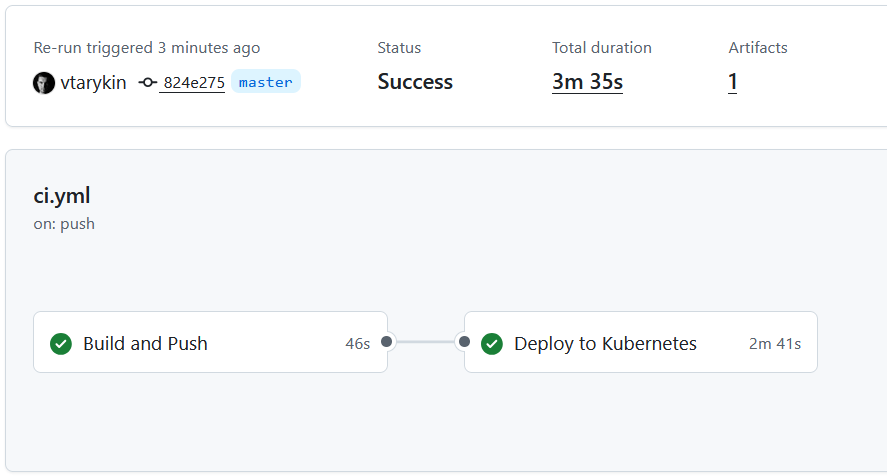
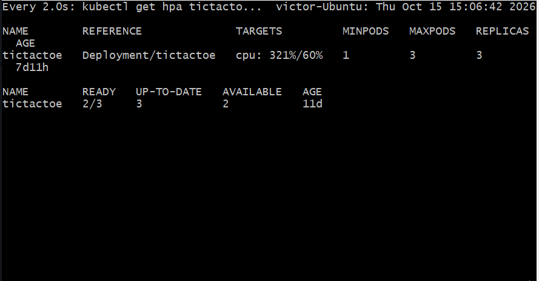
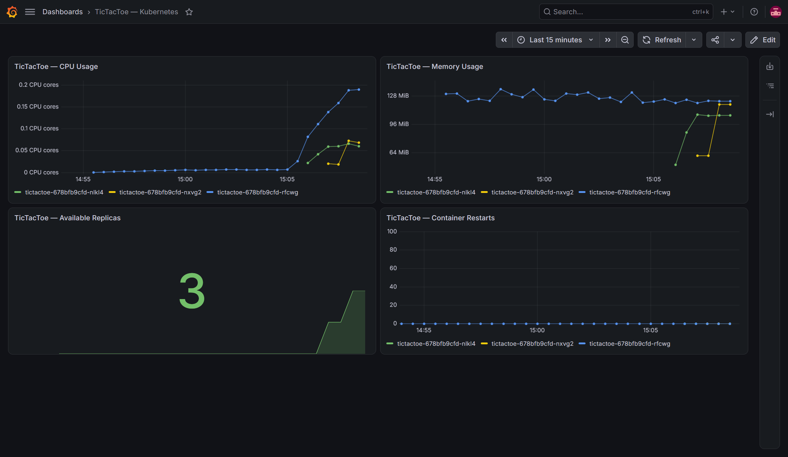
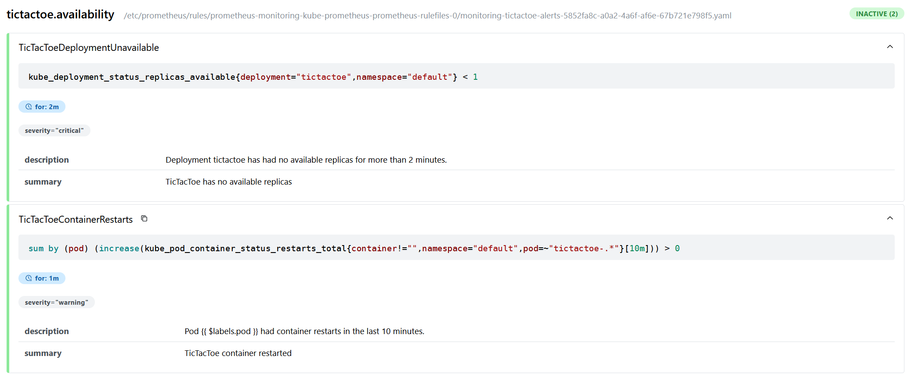

# TicTacToe — Application Delivery and Kubernetes Operations

A DevOps portfolio project built around a Java 21 / Spring Boot application. It demonstrates the application delivery lifecycle: from source code and container image creation to Kubernetes deployment, autoscaling, monitoring, and alert delivery.

The project focuses on infrastructure automation and operational visibility rather than the game logic itself.

## Contents

- [Project Overview](#project-overview)
- [Architecture](#architecture)
- [Solution Overview](#solution-overview)
- [Technology Stack](#technology-stack)
- [Quick Start](#quick-start)
- [CI/CD Pipeline](#cicd-pipeline)
- [Kubernetes and Autoscaling](#kubernetes-and-autoscaling)
- [Infrastructure as Code](#infrastructure-as-code)
- [Monitoring and Observability](#monitoring-and-observability)
- [Alerting and Recovery](#alerting-and-recovery)
- [Repository Structure](#repository-structure)
- [Limitations and Further Improvements](#limitations-and-further-improvements)
- [License](#license)

## Project Overview

The goal of this project is to demonstrate how a containerized application can be built, deployed, monitored, and scaled using commonly used infrastructure tools.

The implementation covers:

- Automated application build and deployment using GitHub Actions.
- Docker image creation and publication to GitHub Container Registry (GHCR).
- Kubernetes workload orchestration using a local `kind` cluster.
- Declarative Kubernetes configuration using Helm and Terraform.
- Horizontal Pod Autoscaling based on CPU utilization.
- Metrics collection and visualization with Prometheus and Grafana.
- Alert delivery through Alertmanager to Telegram.
- Manual rollback between Helm release revisions.

The environment is designed as a reproducible learning and demonstration lab. It is not a production deployment and does not claim production-level availability or performance.

## Architecture



GitHub Actions runs on a self-hosted Ubuntu runner with access to the local Kubernetes cluster. The pipeline builds the application, creates a Docker image, publishes the image to GHCR, and deploys the application to Kubernetes.

Prometheus collects monitoring metrics, Grafana provides dashboards, and Alertmanager routes configured alerts to Telegram.

The Kubernetes cluster is created locally with `kind`. Terraform describes Kubernetes workload resources; it does not provision a managed cloud Kubernetes cluster.

## Solution Overview

| Area | Implementation | Operational purpose |
|---|---|---|
| Application delivery | GitHub Actions, Gradle, Docker, GHCR | Automates build and delivery steps and associates images with source revisions |
| Containerization | Docker | Packages the application and its runtime dependencies |
| Orchestration | Kubernetes, kind | Runs the application as a managed workload |
| Deployment configuration | Helm | Templates Kubernetes resources and manages application releases |
| Infrastructure as Code | Terraform | Represents Kubernetes resources declaratively |
| Autoscaling | Horizontal Pod Autoscaler | Adjusts the number of application replicas based on CPU utilization |
| Monitoring | Prometheus, Grafana | Makes resource usage and workload state observable |
| Alerting | Prometheus rules, Alertmanager | Detects configured conditions and routes notifications |
| Notifications | Telegram | Delivers alerts to an operator through an external messaging channel |

The project illustrates how these tools work together across the application lifecycle, rather than treating them as isolated technologies.

## Technology Stack

| Category | Technologies |
|---|---|
| Application | Java 21, Spring Boot |
| Build | Gradle Wrapper |
| Containerization | Docker |
| Container registry | GitHub Container Registry |
| CI/CD | GitHub Actions, self-hosted runner |
| Orchestration | Kubernetes, kind |
| Deployment configuration | Helm |
| Infrastructure as Code | Terraform |
| Metrics | Prometheus, Metrics Server, kube-state-metrics, node-exporter |
| Dashboards | Grafana |
| Alerting | PrometheusRule, Alertmanager, AlertmanagerConfig |
| Notifications | Telegram |
| Environment | Ubuntu Linux |

## Quick Start

### Prerequisites

To run the application locally:

- Git
- JDK 21

To run it in a container, Docker is also required. Kubernetes deployment additionally requires `kind`, `kubectl`, and Helm.

### Run the Application Locally

Clone the repository and enter the application directory:

```bash
git clone https://github.com/vtarykin/tictactoe.git
cd tictactoe/src/tictactoe
```

Make the Gradle Wrapper executable, build the application, and start it:

```bash
chmod +x ./gradlew
./gradlew clean build
./gradlew bootRun
```

Open the application at:

<http://localhost:8080>

### Run with Docker

From `src/tictactoe/`, build the image:

```bash
./gradlew clean build
docker build -t tictactoe:local .
```

Run the container:

```bash
docker run --rm --name tictactoe -p 8080:8080 tictactoe:local
```

Open <http://localhost:8080>.

### Deploy to a Local Kubernetes Cluster

Create a cluster with `kind`:

```bash
kind create cluster --name tictactoe
kubectl config use-context kind-tictactoe
kubectl get nodes
```

Build the container image and make it available to the kind node:

```bash
cd src/tictactoe
./gradlew clean build
docker build -t tictactoe:local .
kind load docker-image tictactoe:local --name tictactoe
cd ../..
```

Before deploying, check `helm/tictactoe/values.yaml` and configure the image repository, tag, and pull policy to match the image built above. The values must match the keys supported by the chart.

Validate and render the chart:

```bash
helm lint ./helm/tictactoe
helm template tictactoe ./helm/tictactoe
```

Install or upgrade the release:

```bash
helm upgrade --install tictactoe ./helm/tictactoe
```

Check the workload:

```bash
kubectl get deployment,service,hpa
kubectl get pods
```

**Resource ownership note:** this repository contains both Helm and Terraform definitions for Kubernetes resources. Do not use both as independent managers of the same Deployment, Service, or HPA. Choose one management path for a given environment and account for existing resources before deploying.

## CI/CD Pipeline

The GitHub Actions workflow automates the main delivery steps:

1. Builds the Java application with Gradle.
2. Builds a Docker image.
3. Publishes the image to GitHub Container Registry.
4. Deploys the application to the local Kubernetes cluster through a self-hosted runner.

Images use a commit-based tag:

```text
ghcr.io/vtarykin/tictactoe:<commit-sha>
```

This makes it possible to associate a deployed container image with the source revision from which it was built.

The self-hosted runner must be online and able to access the target kind cluster for deployment to complete.

### Pipeline Execution

A successful workflow run provides evidence of the configured build and delivery process.



## Kubernetes and Autoscaling

The application runs in a Kubernetes Deployment and is exposed through a Service. A Horizontal Pod Autoscaler (HPA) adjusts the number of replicas according to observed CPU utilization.

### Resource Configuration

| Parameter | Value |
|---|---:|
| Minimum replicas | 1 |
| Maximum replicas | 3 |
| Target CPU utilization | 60% |
| CPU request per container | 100m |
| CPU limit per container | 500m |
| Memory request per container | 256 Mi |
| Memory limit per container | 512 Mi |
| Scale-down stabilization window | 300 seconds |

### Autoscaling Validation

A CPU-load experiment was performed in the local lab to observe HPA behavior.

| Test stage | Observed result |
|---|---|
| Baseline | One application replica under low CPU utilization |
| Increased load | HPA reported approximately `79% / 60%` CPU utilization |
| Sustained load | HPA reported approximately `94% / 60%`; replicas increased from 1 to 2 and then 3 |
| Load removed | CPU utilization decreased; replicas eventually returned to 1 after the stabilization period |

These values are observations from one local environment and test run, not a throughput benchmark or a guarantee of application latency under arbitrary workloads.

The following terminal output can be used to observe the HPA and Deployment:

```bash
kubectl get hpa tictactoe
kubectl get deployment tictactoe
kubectl top pods
```

The screenshot below documents the autoscaling behavior observed during the load experiment.



## Infrastructure as Code

The repository includes both a Helm chart and Terraform configuration for Kubernetes workload resources.

### Helm

The chart is located at `helm/tictactoe/`.

Helm templates Kubernetes manifests and manages application releases. It provides a consistent interface for rendering and deploying the workload with configurable values.

Useful validation commands include:

```bash
helm lint ./helm/tictactoe
helm template tictactoe ./helm/tictactoe
helm history tictactoe
```

### Terraform

The Terraform configuration is located at `terraform/`.

It describes Kubernetes resources, including the application Deployment, Service, and HPA. The configuration has previously been validated and reviewed with a Terraform plan in the local environment.

Typical inspection commands are:

```bash
cd terraform
terraform init
terraform validate
terraform plan
```

Terraform requires access to the configured providers and a valid Kubernetes configuration. Review the plan before applying any changes.

The Terraform configuration ignores changes to the container image field so a CI/CD deployment can update the application version without Terraform automatically reverting it.

**Ownership must be explicit.** Helm and Terraform should not independently manage the same resource without a deliberate ownership strategy. This project keeps both approaches for demonstration, but an environment should have a clear source of truth for each resource.

## Monitoring and Observability

The monitoring stack is based on `kube-prometheus-stack` and includes:

- **Prometheus** for metrics collection and alert evaluation.
- **Grafana** for visualizing application and Kubernetes metrics.
- **Alertmanager** for routing notifications.
- **kube-state-metrics** for Kubernetes resource state metrics.
- **node-exporter** for node-level metrics.
- **Metrics Server** for resource metrics consumed by HPA.

The custom Grafana dashboard, `TicTacToe — Kubernetes`, provides visibility into:

- Application pod CPU usage.
- Container memory usage.
- Available Deployment replicas.
- Container restarts.

This helps correlate resource utilization with scaling behavior and workload state.

### Grafana Dashboard



### Access Monitoring Locally

If the monitoring stack is already installed, use port forwarding to access its interfaces.

Grafana:

```bash
kubectl port-forward -n monitoring \
  svc/monitoring-grafana 3000:80
```

Open <http://localhost:3000>.

To retrieve the Grafana admin password from the Kubernetes Secret:

```bash
kubectl get secret -n monitoring monitoring-grafana \
  -o jsonpath='{.data.admin-password}' | base64 --decode
echo
```

Prometheus:

```bash
kubectl port-forward -n monitoring \
  svc/monitoring-kube-prometheus-prometheus 9090:9090
```

Open <http://localhost:9090>.

These commands assume the release and service names used by the current lab.

**Reproducibility note:** the local kind environment includes specific changes to control-plane metrics endpoints so Prometheus can scrape them. Such settings are lab-specific and require appropriate network controls in shared or production environments. The monitoring configuration is not yet fully reproducible from a clean checkout.

## Alerting and Recovery

Alertmanager is configured to send notifications to Telegram. The bot token is supplied through a Kubernetes Secret rather than stored in the repository.

The tracked Alertmanager configuration template is located at:

```text
monitoring/alertmanager-telegram.yaml.tpl
```

### Configured Alert Conditions

| Alert | Condition | Duration |
|---|---|---:|
| `TicTacToeDeploymentUnavailable` | No available replicas for the application Deployment | 2 minutes |
| `TicTacToeContainerRestarts` | Application container restarts detected over a 10-minute window | 1 minute |

These rules were applied and tested in the local cluster. A test notification was successfully delivered to Telegram, verifying the notification path.

The PrometheusRule manifest still needs to be committed to the repository for the alert rules to be recreated from a clean environment.

### Alert Rules

The Prometheus alert rules can be inspected through the Prometheus Alerts page at:

<http://localhost:9090/alerts>



The exact state of each alert depends on current metrics. An alert may be inactive when the workload is healthy; this does not mean the rule is missing.

### Rollback

A manual rollback between Helm release revisions has been exercised in the local environment.

Helm release history can be inspected with:

```bash
helm history tictactoe
```

A rollback can be initiated with:

```bash
helm rollback tictactoe <REVISION>
```

Replace `<REVISION>` with the intended revision from the release history. Confirm that Helm is the current owner of the resources before using this procedure.

Automatic rollback triggered by an alert is not implemented. Alert delivery notifies the operator, while the rollback decision remains manual. Any rollback must account for the desired state maintained by the deployment pipeline and the tool managing the Kubernetes resources.

## Repository Structure

```text
.
├── .github/workflows/          # CI/CD workflow definitions
├── docs/images/                # README screenshots and supporting visuals
├── helm/tictactoe/             # Helm chart
├── k8s/                        # Kubernetes manifests
├── monitoring/                 # Monitoring and alerting configuration
├── src/tictactoe/              # Java application, Gradle Wrapper, Dockerfile
├── terraform/                  # Terraform configuration
├── .gitignore                  # Git exclusions
├── README.md                   # Project overview, architecture, and run instructions
└── README_RUS.md               # Project overview in Russian
```

## Limitations and Further Improvements

The current project demonstrates a local application delivery pipeline, Kubernetes deployment, CPU-based autoscaling, resource dashboards, Telegram alert delivery, and manual rollback.

The following improvements remain outside the verified scope:

- Commit all alert-rule manifests and the required monitoring configuration for reproducible setup.
- Add automated application tests as a required CI stage.
- Integrate container and dependency vulnerability scanning and SBOM generation.
- Add post-deployment smoke tests.
- Export HTTP request-duration metrics and define measurable latency and availability SLOs.
- Explore deployment to a cloud-managed Kubernetes environment.

Kubernetes and container resource metrics are collected, but the project does not currently implement or validate an application request-latency SLO such as p99 below 800 ms. No such performance claim is made.

## License

No `LICENSE` file is currently specified in the repository. The project is therefore not presented as being distributed under a particular open-source license.