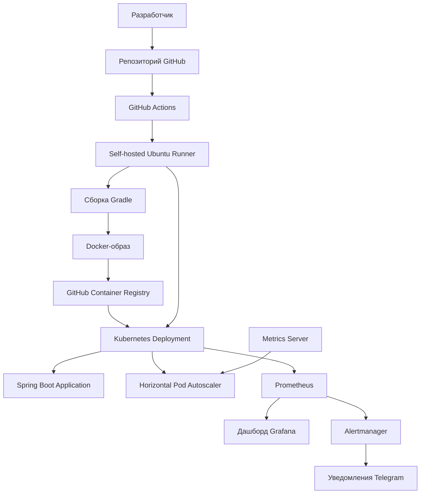

# TicTacToe — доставка приложения и эксплуатация в Kubernetes

DevOps-проект на базе Java 21 и Spring Boot, демонстрирующий жизненный цикл доставки приложения: от исходного кода и сборки контейнерного образа до развёртывания в Kubernetes, автомасштабирования, мониторинга и отправки уведомлений.

Основной фокус проекта — автоматизация инфраструктуры и контроль состояния работающего приложения, а не игровая логика.

**Репозиторий:** [github.com/vtarykin/tictactoe](https://github.com/vtarykin/tictactoe)

## Содержание

- [Обзор проекта](#обзор-проекта)
- [Архитектура](#архитектура)
- [Решаемые задачи](#решаемые-задачи)
- [Технологический стек](#технологический-стек)
- [Быстрый запуск](#быстрый-запуск)
- [CI/CD](#cicd)
- [Kubernetes и автомасштабирование](#kubernetes-и-автомасштабирование)
- [Infrastructure as Code](#infrastructure-as-code)
- [Мониторинг и наблюдаемость](#мониторинг-и-наблюдаемость)
- [Оповещения и восстановление](#оповещения-и-восстановление)
- [Структура репозитория](#структура-репозитория)
- [Ограничения и дальнейшее развитие](#ограничения-и-дальнейшее-развитие)
- [Лицензия](#лицензия)

## Обзор проекта

Цель проекта — продемонстрировать, как контейнеризированное приложение можно собирать, развёртывать, масштабировать и контролировать с помощью распространённых инфраструктурных инструментов.

Реализованы следующие возможности:

- Автоматизированные сборка приложения и развёртывание с помощью GitHub Actions.
- Создание Docker-образов и публикация в GitHub Container Registry (GHCR).
- Оркестрация приложения в локальном кластере Kubernetes на базе `kind`.
- Декларативное описание Kubernetes-ресурсов с помощью Helm и Terraform.
- Горизонтальное автомасштабирование Pod на основе загрузки CPU.
- Сбор и визуализация метрик с помощью Prometheus и Grafana.
- Отправка оповещений через Alertmanager в Telegram.
- Ручной откат между ревизиями Helm-релиза.

Проект представляет собой практический демонстрационный стенд. Он не является промышленным развёртыванием и не заявляется как инфраструктура с гарантированными показателями доступности или производительности.

## Архитектура



GitHub Actions использует собственный runner на Ubuntu с доступом к локальному кластеру `kind`. Pipeline собирает приложение, создаёт Docker-образ, публикует его в GHCR и развёртывает приложение в Kubernetes.

Prometheus собирает метрики, Grafana предоставляет дашборды, а Alertmanager отправляет настроенные оповещения в Telegram.

Кластер Kubernetes работает локально на `kind`. Terraform описывает ресурсы Kubernetes, но не создаёт управляемый облачный кластер.

## Решаемые задачи

| Область | Реализация | Назначение |
|---|---|---|
| Доставка приложения | GitHub Actions, Gradle, Docker, GHCR | Автоматизация сборки и доставки с привязкой образов к версиям исходного кода |
| Контейнеризация | Docker | Упаковка приложения и его зависимостей |
| Оркестрация | Kubernetes, kind | Управление запущенным приложением |
| Конфигурация развёртывания | Helm | Шаблонизация Kubernetes-манифестов и управление релизами |
| Infrastructure as Code | Terraform | Декларативное описание инфраструктурных ресурсов |
| Автомасштабирование | Horizontal Pod Autoscaler | Изменение количества реплик в зависимости от загрузки CPU |
| Мониторинг | Prometheus, Grafana | Контроль использования ресурсов и состояния приложения |
| Оповещения | Prometheus rules, Alertmanager | Обнаружение заданных условий и маршрутизация уведомлений |
| Уведомления | Telegram | Доставка оповещений оператору |

Проект демонстрирует взаимодействие инструментов на разных этапах жизненного цикла приложения, а не просто их изолированное применение.

## Технологический стек

| Категория | Технологии |
|---|---|
| Приложение | Java 21, Spring Boot |
| Сборка | Gradle Wrapper |
| Контейнеризация | Docker |
| Реестр образов | GitHub Container Registry |
| CI/CD | GitHub Actions, self-hosted runner |
| Оркестрация | Kubernetes, kind |
| Конфигурация развёртывания | Helm |
| Infrastructure as Code | Terraform |
| Метрики | Prometheus, Metrics Server, kube-state-metrics, node-exporter |
| Дашборды | Grafana |
| Оповещения | PrometheusRule, Alertmanager, AlertmanagerConfig |
| Уведомления | Telegram |
| Операционная система | Ubuntu Linux |

## Быстрый запуск

### Предварительные требования

Для локального запуска приложения необходимы:

- Git;
- JDK 21.

Для запуска в контейнере также потребуется Docker. Для развёртывания в Kubernetes необходимы `kind`, `kubectl` и Helm.

### Локальный запуск приложения

Клонируйте репозиторий и перейдите в каталог приложения:

```bash
git clone https://github.com/vtarykin/tictactoe.git
cd tictactoe/src/tictactoe
```

Сделайте Gradle Wrapper исполняемым, соберите приложение и запустите его:

```bash
chmod +x ./gradlew
./gradlew clean build
./gradlew bootRun
```

Откройте приложение по адресу:

<http://localhost:8080>

### Запуск в Docker

Из каталога `src/tictactoe/` соберите образ:

```bash
./gradlew clean build
docker build -t tictactoe:local .
```

Запустите контейнер:

```bash
docker run --rm --name tictactoe -p 8080:8080 tictactoe:local
```

Откройте <http://localhost:8080>.

### Развёртывание в локальном Kubernetes

Создайте кластер с помощью `kind`:

```bash
kind create cluster --name tictactoe
kubectl config use-context kind-tictactoe
kubectl get nodes
```

Соберите образ и загрузите его в узел `kind`:

```bash
cd src/tictactoe
./gradlew clean build
docker build -t tictactoe:local .
kind load docker-image tictactoe:local --name tictactoe
cd ../..
```

Перед развёртыванием проверьте `helm/tictactoe/values.yaml` и настройте репозиторий образа, тег и политику загрузки в соответствии с собранным образом. Убедитесь, что параметры соответствуют ключам, которые используются в шаблонах Helm chart.

Проверьте chart и сформируйте Kubernetes-манифесты:

```bash
helm lint ./helm/tictactoe
helm template tictactoe ./helm/tictactoe
```

Установите релиз или обновите существующий:

```bash
helm upgrade --install tictactoe ./helm/tictactoe
```

Проверьте состояние приложения:

```bash
kubectl get deployment,service,hpa
kubectl get pods
```

**Важно об управлении ресурсами:** в репозитории имеются конфигурации одних и тех же типов Kubernetes-ресурсов для Helm и Terraform. Не следует независимо управлять одним Deployment, Service или HPA с помощью обоих инструментов. Для каждого окружения необходимо выбрать способ управления ресурсами и проверить их текущее состояние до развёртывания.

## CI/CD

Pipeline на GitHub Actions автоматизирует основные этапы доставки приложения:

1. Сборка Java-приложения с помощью Gradle.
2. Создание Docker-образа.
3. Публикация образа в GitHub Container Registry.
4. Развёртывание приложения в локальном Kubernetes-кластере через self-hosted runner.

Для образов используется тег, соответствующий коммиту:

```text
ghcr.io/vtarykin/tictactoe:<commit-sha>
```

Это позволяет связать опубликованный образ с конкретной ревизией исходного кода.

Для успешного развёртывания self-hosted runner должен быть доступен и иметь возможность подключаться к целевому кластеру `kind`.

### Выполнение pipeline

Успешный запуск workflow подтверждает выполнение настроенных этапов сборки и доставки приложения.


## Kubernetes и автомасштабирование

Приложение запускается в Kubernetes Deployment и доступно через Service. Horizontal Pod Autoscaler (HPA) изменяет количество реплик на основе наблюдаемой загрузки CPU.

### Конфигурация ресурсов

| Параметр | Значение |
|---|---:|
| Минимальное количество реплик | 1 |
| Максимальное количество реплик | 3 |
| Целевая загрузка CPU для HPA | 60% |
| CPU request на контейнер | 100m |
| CPU limit на контейнер | 500m |
| Memory request на контейнер | 256 Mi |
| Memory limit на контейнер | 512 Mi |
| Окно стабилизации при уменьшении числа реплик | 300 секунд |

### Проверка автомасштабирования

В локальном окружении был проведён эксперимент с искусственной CPU-нагрузкой для проверки поведения HPA.

| Этап теста | Наблюдаемый результат |
|---|---|
| Исходное состояние | Одна реплика приложения при низкой загрузке CPU |
| Увеличение нагрузки | HPA показывал примерно `79% / 60%` |
| Продолжительная нагрузка | HPA показывал примерно `94% / 60%`; количество реплик увеличилось с 1 до 2, затем до 3 |
| Прекращение нагрузки | Загрузка CPU снизилась, после периода стабилизации количество реплик вернулось к 1 |

Значения отражают результаты одного тестового запуска в локальном окружении. Они не являются результатами бенчмарка пропускной способности и не гарантируют определённую задержку приложения при произвольной нагрузке.

Наблюдать за HPA и Deployment можно с помощью команд:

```bash
kubectl get hpa tictactoe
kubectl get deployment tictactoe
kubectl top pods
```

На скриншоте показано поведение автомасштабирования во время теста.


## Infrastructure as Code

В репозитории представлены Helm chart и конфигурация Terraform для управления ресурсами Kubernetes.

### Helm

Chart расположен в каталоге `helm/tictactoe/`.

Helm шаблонизирует Kubernetes-манифесты и управляет релизами приложения. Это позволяет использовать единый механизм настройки и развёртывания приложения с помощью конфигурационных параметров.

Команды для проверки:

```bash
helm lint ./helm/tictactoe
helm template tictactoe ./helm/tictactoe
helm history tictactoe
```

### Terraform

Конфигурация Terraform расположена в каталоге `terraform/`.

Она описывает Kubernetes-ресурсы, включая Deployment приложения, Service и HPA. Конфигурация ранее проходила `terraform validate` и проверку с помощью `terraform plan` в локальном окружении.

Основные команды для проверки:

```bash
cd terraform
terraform init
terraform validate
terraform plan
```

Для работы Terraform необходимы доступ к настроенным провайдерам и корректная конфигурация подключения к Kubernetes. Перед применением изменений следует внимательно проверить план.

В конфигурации Terraform игнорируются изменения поля с образом контейнера, чтобы обновления версии приложения через CI/CD не отменялись автоматически при следующем применении Terraform.

**Владение ресурсами должно быть определено явно.** Helm и Terraform не должны независимо управлять одним ресурсом без согласованной стратегии. В репозитории представлены оба подхода, однако для каждого окружения необходимо определить единый источник истины для каждого ресурса.

## Мониторинг и наблюдаемость

Стек мониторинга основан на `kube-prometheus-stack` и включает:

- **Prometheus** — сбор метрик и вычисление условий оповещений.
- **Grafana** — визуализация метрик приложения и Kubernetes.
- **Alertmanager** — маршрутизация уведомлений.
- **kube-state-metrics** — метрики состояния Kubernetes-ресурсов.
- **node-exporter** — метрики узлов.
- **Metrics Server** — сбор ресурсных метрик, используемых HPA.

В Grafana создан дашборд `TicTacToe — Kubernetes`, который позволяет отслеживать:

- загрузку CPU подами приложения;
- использование памяти контейнерами;
- количество доступных реплик Deployment;
- перезапуски контейнеров.

Эти метрики позволяют сопоставлять использование ресурсов с изменением количества реплик и состоянием приложения.

### Дашборд Grafana


### Доступ к мониторингу

Если стек мониторинга уже установлен, для доступа к его интерфейсам можно использовать `kubectl port-forward`.

Grafana:

```bash
kubectl port-forward -n monitoring svc/monitoring-grafana 3000:80
```

Откройте <http://localhost:3000>.

Получить пароль администратора Grafana из Kubernetes Secret можно командой:

```bash
kubectl get secret -n monitoring monitoring-grafana \
  -o jsonpath='{.data.admin-password}' | base64 --decode
echo
```

Prometheus:

```bash
kubectl port-forward -n monitoring \
  svc/monitoring-kube-prometheus-prometheus 9090:9090
```

Откройте <http://localhost:9090>.

Команды предполагают, что имена релиза и сервисов соответствуют текущему локальному окружению.

**Ограничение воспроизводимости:** в локальном `kind` изменена конфигурация некоторых конечных точек метрик компонентов control plane, чтобы Prometheus мог собирать их метрики. Эти настройки относятся к лабораторному окружению и при использовании в общей или промышленной инфраструктуре требуют соответствующих сетевых ограничений. В настоящее время мониторинг ещё не полностью воспроизводится из чистого клона репозитория.

## Оповещения и восстановление

Alertmanager настроен на отправку уведомлений в Telegram. Токен бота передаётся через Kubernetes Secret и не хранится в репозитории.

Шаблон конфигурации Alertmanager находится в файле:

```text
monitoring/alertmanager-telegram.yaml.tpl
```

### Настроенные условия оповещения

| Правило | Условие | Длительность |
|---|---|---:|
| `TicTacToeDeploymentUnavailable` | У приложения отсутствуют доступные реплики Deployment | 2 минуты |
| `TicTacToeContainerRestarts` | Обнаружены перезапуски контейнера приложения за 10-минутный интервал | 1 минута |

Эти правила были применены и проверены в локальном кластере. Тестовое уведомление успешно доставлено в Telegram, что подтвердило работоспособность канала доставки уведомлений.

Манифест `PrometheusRule` ещё необходимо добавить в репозиторий, чтобы правила оповещения можно было воссоздать в чистом окружении.

### Правила оповещения

После запуска проброса порта правила можно просмотреть на странице Alerts в Prometheus:

<http://localhost:9090/alerts>


Состояние каждого правила зависит от текущих метрик. При штатной работе приложения оповещение может находиться в состоянии `Inactive`. Это не означает, что правило отсутствует.

### Откат версии

В локальном окружении проверялся ручной откат между ревизиями Helm-релиза.

Посмотреть историю релиза:

```bash
helm history tictactoe
```

Выполнить откат к выбранной ревизии:

```bash
helm rollback tictactoe <REVISION>
```

Вместо `<REVISION>` укажите номер нужной ревизии из истории. Перед откатом убедитесь, что текущими ресурсами управляет Helm.

Автоматический откат, запускаемый при срабатывании оповещения, не реализован. Alertmanager уведомляет оператора, а решение об откате принимается вручную. При этом необходимо учитывать желаемое состояние, определённое CI/CD и инструментом управления ресурсами, чтобы последующая синхронизация не вернула проблемную версию.

## Структура репозитория


```text
.
├── .github/workflows/          # Конфигурации CI/CD workflow
├── docs/images/                # Скриншоты и иллюстрации для README
├── helm/tictactoe/             # Helm chart приложения
├── k8s/                        # Kubernetes-манифесты
├── monitoring/                 # Конфигурация мониторинга и оповещений
├── src/tictactoe/              # Java-приложение, Gradle Wrapper, Dockerfile
├── terraform/                  # Конфигурация Terraform
├── .gitignore                  # Исключения для Git
├── README.md                   # Описание проекта, архитектура и инструкции по запуску 
└── README_RUS.md               # Описание проекта на русском
```

## Ограничения и дальнейшее развитие

Текущая реализация демонстрирует локальный pipeline доставки приложения, развёртывание в Kubernetes, автомасштабирование по CPU, мониторинг ресурсов, доставку уведомлений в Telegram и ручной откат версии.

Следующие улучшения пока не входят в подтверждённый функционал проекта:

- Добавить в репозиторий все манифесты правил оповещения и необходимые настройки мониторинга для воспроизводимого развёртывания.
- Добавить автоматические тесты приложения в обязательные этапы CI.
- Интегрировать сканирование уязвимостей контейнера и зависимостей, а также генерацию SBOM.
- Добавить smoke-тесты после развёртывания.
- Экспортировать метрики времени HTTP-запросов и определить измеримые SLO доступности и задержки.
- Рассмотреть развёртывание в облачной управляемой среде Kubernetes.

Метрики Kubernetes и контейнеров собираются, однако проект пока не реализует и не проверяет SLO задержки запросов приложения, например p99 менее 800 мс. В README не заявляется соответствие такому показателю производительности.

## Лицензия

В репозитории пока не указан файл `LICENSE`, поэтому проект не заявляется как распространяемый под конкретной открытой лицензией.